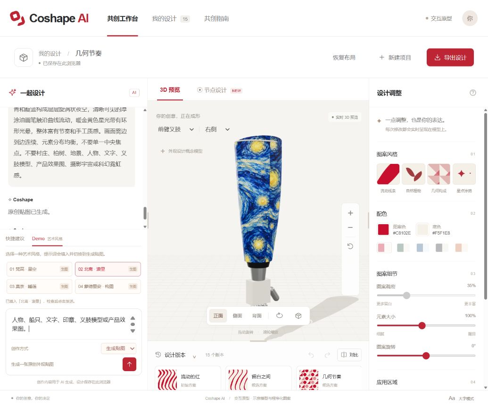

# Coshape AI

> 让义肢呈现你的风格。

Coshape AI 是一个面向不同年龄阶段义肢使用者的外观共创工作台。用户可以通过自然语言、艺术风格 Demo、可视化参数和节点编辑器设计个性化贴图，并实时查看贴图在小腿或前臂义肢示意模型上的效果。

[在线体验](https://coshape-design-studio.gardengoose8.chatgpt.site/studio/) · [部署说明](#部署)



## 功能

- 小腿、前臂两类 3D 义肢示意模型，支持左右侧切换、旋转、缩放、自动旋转和网格查看。
- AI 对话调整设计参数，AI 生成原创平面贴图并映射到义肢外观罩。
- 梵高《星空》、葛饰北斋《神奈川冲浪里》、莫奈《睡莲》和蒙德里安构图四组艺术风格 Demo。
- 流线、植物、几何和星点程序化图案，以及配色、疏密、缩放、旋转和表面效果控制。
- 节点式图案编辑，可组合图形、排列、变换、配色和输出节点。
- 上半部、下半部和全部区域的局部应用；未编辑区域保持原样。
- 浏览器本地保存、版本切换、撤销、重做和版本对比。
- 导出 2048 px PNG 贴图、当前 3D 视角 PNG 和 JSON 设计说明。
- 可拖动调整对话区、参数区、实时图案区和版本区的尺寸。

## 技术结构

```text
浏览器工作台
  ├─ Three.js 3D 预览
  ├─ Canvas / 节点图案渲染
  ├─ IndexedDB 原创贴图存储
  └─ /api/chat 与 /api/image
           ↓
Vinext / Cloudflare Worker
  ├─ 服务端模型与密钥配置
  ├─ 参数白名单与响应校验
  ├─ 图片格式和下载域名校验
  └─ OpenAI 兼容文本与生图网关
```

前端源码位于 `public/studio/`，API 路由位于 `app/api/`，服务端适配和安全校验位于 `lib/`。构建产物写入 `dist/`，请勿直接修改该目录。

## 本地运行

环境要求：Node.js 22.13 或更高版本，npm 10 或更高版本。

```bash
git clone https://github.com/jackhan123/Nowiz-agent.git
cd Nowiz-agent
npm install
```

复制环境变量模板：

```bash
cp .env.example .dev.vars
```

在 `.dev.vars` 中填写服务端密钥与模型，然后启动开发环境：

```bash
npm run dev
```

终端会显示本地访问地址。进入 `/studio/` 即可打开工作台。

## 环境变量

| 变量 | 是否必需 | 用途 |
|---|---:|---|
| `COSHAPE_GATEWAY_API_KEY` | 是 | 文本模型网关密钥 |
| `COSHAPE_IMAGE_API_KEY` | 否 | 生图服务密钥；未设置时使用文本模型密钥 |
| `COSHAPE_API_BASE_URL` | 否 | OpenAI 兼容网关地址 |
| `COSHAPE_CHAT_MODEL` | 否 | 文本模型名称 |
| `COSHAPE_IMAGE_MODEL` | 否 | 生图模型名称 |
| `COSHAPE_IMAGE_DOWNLOAD_HOSTS` | 否 | 额外允许下载图片的 HTTPS 主机，多个值用逗号分隔 |

所有密钥只应配置在服务端环境中。不要把真实密钥提交到 GitHub，也不要让浏览器直接调用模型服务。

## 验证与构建

```bash
node --test tests/*.test.mjs
npm run build
```

测试覆盖 API 协议、服务端配置隔离、参数白名单、区域保护、图片格式与下载限制，以及节点图案计算。自动测试使用模拟响应，不消耗模型额度。

## 部署

### 方法一：ChatGPT Sites

仓库已经包含 `.openai/hosting.json`，用于关联现有 Coshape AI Site。通过 Codex / ChatGPT Sites 打开本仓库后：

1. 在 Site 的运行时环境变量中配置上表所列变量。
2. 执行测试和 `npm run build`。
3. 保存新版本并发布，继续沿用 `.openai/hosting.json` 中的项目身份。

已发布地址：<https://coshape-design-studio.gardengoose8.chatgpt.site/studio/>

### 方法二：Cloudflare Workers

先安装依赖并生成 Worker 产物：

```bash
npm install
npm run build
npx wrangler login
npx wrangler deploy --config dist/server/wrangler.json --name coshape-ai
```

首次部署后，在 Cloudflare Dashboard 的 Worker 设置中添加环境变量，或使用 Wrangler 写入：

```bash
npx wrangler secret put COSHAPE_GATEWAY_API_KEY --name coshape-ai
npx wrangler secret put COSHAPE_IMAGE_API_KEY --name coshape-ai
npx wrangler secret put COSHAPE_API_BASE_URL --name coshape-ai
npx wrangler secret put COSHAPE_CHAT_MODEL --name coshape-ai
npx wrangler secret put COSHAPE_IMAGE_MODEL --name coshape-ai
```

如果生图接口返回图片 URL，并且图片托管主机不在默认许可列表中，再设置 `COSHAPE_IMAGE_DOWNLOAD_HOSTS`。环境变量配置完成后重新执行部署命令。

## 数据与安全

- 设计版本和生成贴图默认保存在当前浏览器的 Local Storage 与 IndexedDB 中。
- 清除浏览器数据或更换设备前，请先导出贴图和设计说明。
- 服务端忽略浏览器提交的模型、密钥和目标地址，避免客户端覆盖托管配置。
- 模型输出必须通过结构化参数、图片类型和尺寸校验后才会应用到画布。
- 项目只用于义肢外观设计概念。承重结构、接受腔、固定装置、关节与临床适配必须由专业人员评估。

## 主要目录

```text
app/                 页面与 API 路由
lib/                 AI 适配、安全校验和运行时配置
public/studio/       工作台界面、3D 渲染、节点编辑与本地存储
tests/               自动测试
.openai/hosting.json Sites 项目配置
```

第三方 3D 渲染依赖为 Three.js r180，许可证随构建资源一同保留。
